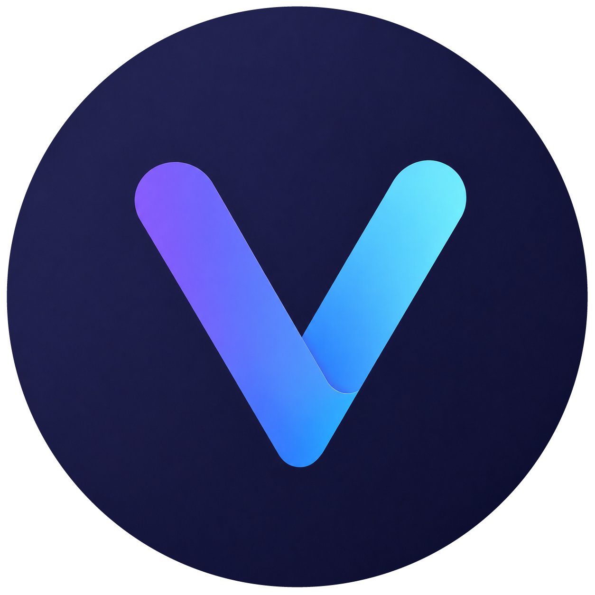

# Stride

**A desktop job-application tracker that turns your saved jobs into focused "apply sessions", so you spend less time organizing and more time applying.**

<br clear="left">

<!-- Add a screenshot of the Dashboard and a GIF of Apply Mode here:

 -->

## Why it exists

During my new-grad job search, the real problem wasn't storing jobs. It was actually applying to them. Links were scattered, it was hard to remember what I'd already applied to, and organizing took over from applying. Stride is built around one loop: **find jobs → queue them → work through them one by one.**

## Key features

- **Apply Mode.** A compact, always-on-top window that walks you through unapplied jobs one at a time. Mark each one **Done** or **Skip**, and a session timer runs as you go. You can resize the window, change its opacity, or let clicks pass through to the window behind it.
- **Paste a link and the details fill in.** Stride reads company, role, location, and job description from the posting's page. It falls back to parsing the URL for Greenhouse, Lever, Ashby, and Workday links.
- **Discover new-grad roles.** A built-in feed collects new-grad and entry-level postings from the SimplifyJobs list and curated company boards on Greenhouse, Lever, and Ashby. Save any posting to your tracker in one click.
- **Track every application.** Statuses run Unapplied → Applied → OA → Interview → Offer / Rejected. There are grid and table views, filters, sorting, and a details page for notes.
- **Session history and backups.** Every apply session is logged with its duration and counts of applied and skipped jobs. You can save named backups of your data and export it to CSV.

## Tech stack

- **Electron** for the desktop shell: frameless windows, IPC bridge, always-on-top overlay
- **React 19** + **Vite** for the UI
- **Tailwind CSS** + custom CSS themes (light / dark)
- **Framer Motion** (animation) and **Lucide** (icons)
- **SQLite** through Node's built-in `node:sqlite` for local storage. No account or server is needed.

## Run locally

**Requirements:** Node.js 20.19+ and npm.

```bash
npm install
npm run dev     # starts Vite and launches the Electron app
```

**Build a Windows installer:**

```bash
npm run dist    # outputs an NSIS installer to /release
```

## Project structure

```
electron/               # Main process: windows, IPC, SQLite storage, backups, job-link parser
src/features/
  apply-mode/           # Focused apply-session overlay
  dashboard/            # Today's queue, session summary, quick links
  discover/             # New-grad job feed
  library/              # Application tracker (grid/table, filters, job details)
  sessions/             # Apply-session history
  settings/             # Theme, goals, backups, CSV export
src/components/         # Shared layout and UI building blocks
```

See [CHANGELOG.md](CHANGELOG.md) for how the project developed.
